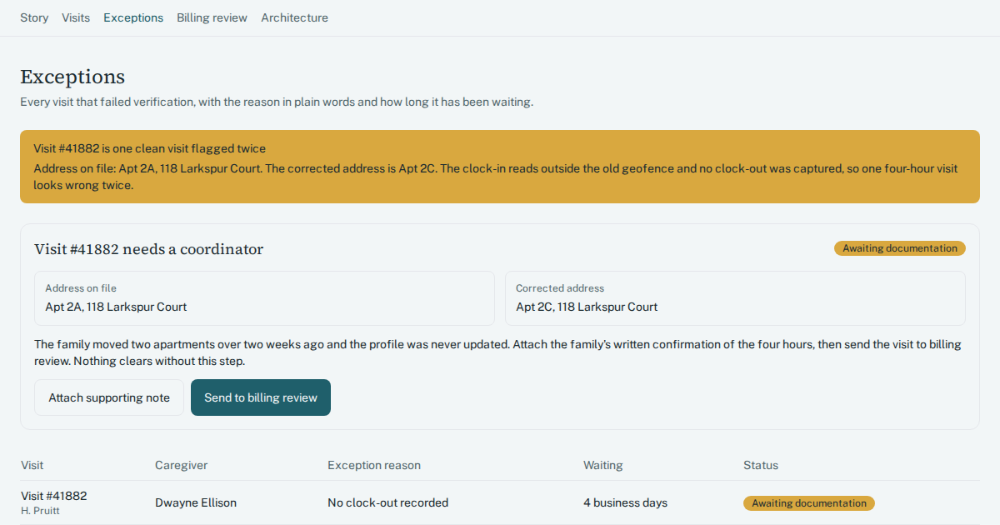

# Home care visit verification and billing hold queue

One queue for home care visits with missing or mismatched EVV records, held from billing until a coordinator signs off.

## Who has this problem

Home care agencies that bill Medicaid waiver programs and pay caregivers weekly. The example in the demo is a 32-caregiver agency with about 340 visits a week. Visit data lives in three places that do not reconcile: the scheduling system, the caregiver mobile app, and the state EVV aggregator file. A coordinator pastes all three into a spreadsheet every Monday and hunts for blanks and mismatches by eye.

In the demo, that costs 9 to 11 hours a week. About 130 caregiver hours sit on hold until exceptions clear, and roughly $3,100 in wages reaches caregivers after payday. Last week 38 visits came back flagged, and two caregivers were paid late.

## What the demo shows

The tour has eight steps, in this order.

1. **Meet Marisol.** The story screen introduces the coordinator and her Monday morning, before and after.
2. **Every visit in one list.** The visit tracker shows last week's visits, already checked against the state EVV file, with the ones that need a person at the top.
3. **The whole story of a visit.** The visit detail screen shows the schedule, clock events, the aggregator response, and every call and note since.
4. **A visit missing its clock-out.** In Exceptions, visit #41882 (caregiver Dwayne Ellison) is flagged "No clock-out recorded", with a live age in business days.
5. **The address that moved.** The client moved two apartments over and the profile was never updated. One good four-hour visit was flagged twice. Marisol corrects the address and attaches the family's written confirmation.
6. **Marisol signs off.** In Billing review, she clicks "Approve for billing". Nothing is meant to reach claims or payroll without that click.
7. **The numbers that matter.** Visits waiting, caregiver hours on hold, the 7-day exception rate, and average days to clear an exception.
8. **How this would be built.** The architecture screen shows the systems the queue sits between.

## How it's built

A browser-only React + TypeScript + Tailwind app on the Umakes kit. It runs on synthetic seed data: 320 visits, 34 caregivers, 62 clients and 260 visit notes. Metrics are computed from the records, not typed in. The Umakes App Factory built and checked it: automated gates, then a reviewer that uses the app like a person would. The architecture screen lays out the scheduling system, caregiver app, state aggregator, clearinghouse and payroll provider around the queue.

## What a production version adds

- Real integrations with the scheduling system, the caregiver app, the state EVV aggregator, a claims clearinghouse and a payroll provider.
- HIPAA controls: role-based access control (caregivers see only their clients), an append-only audit log of every exception decision, encryption at rest and in transit, and signed BAAs for any AI-assisted explanation of an exception.
- Retention and export in the state's required EVV format.
- Deployment on the client's own cloud (GCP). The client owns the code and the data.

## Try it

Live demo: https://umakescloud-max.github.io/evv-visit-exception-queue-v1/

## Honesty line

This is a concept prototype running on synthetic data. A real build runs on the client's own cloud, HIPAA-ready, and the client owns it.

If your team fights this every week, book a free workflow audit at umakes.cloud or reply to umakescloud@gmail.com.
